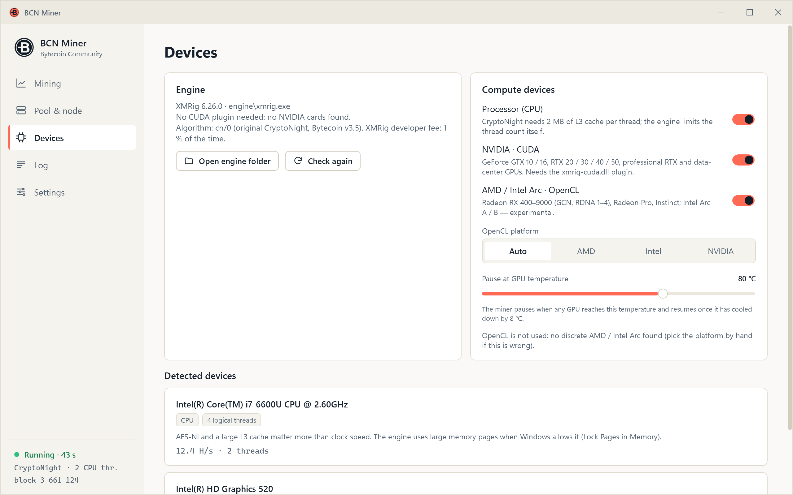

# BCN Miner para Windows

[English](README.md) · [Українська](README.uk.md) · **Español** · [Português](README.pt.md) · [Türkçe](README.tr.md) · [Bahasa Indonesia](README.id.md) · [Tiếng Việt](README.vi.md) · [中文](README.zh.md)

Minero de escritorio para Bytecoin (BCN) que mina con la CPU y con tarjetas gráficas NVIDIA, AMD e Intel Arc. Tiene tema oscuro y claro, e interfaz en ocho idiomas.

Es un proyecto independiente de la comunidad Bytecoin, sin relación con los fundadores de Bytecoin ni con bcndev.


## Descarga y ejecución

1. Descarga `BCNMiner-<versión>-win-portable.zip` desde [bytecoin.community](https://bytecoin.community/#downloads) y descomprímelo donde quieras, incluso en una memoria USB.
2. Ejecuta `BCNMiner.exe` y pulsa **Descargar motor** (en la pantalla Dispositivos o en el aviso de la pantalla Minería). El minero descarga la versión oficial de [XMRig](https://github.com/xmrig/xmrig) desde GitHub, comprueba su SHA-256 y, para tarjetas NVIDIA, añade el plugin xmrig-cuda compilado para tu driver. Desde la línea de comandos se hace lo mismo con `powershell -ExecutionPolicy Bypass -File .\get-engine.ps1`.

No hay que instalar nada: .NET Framework 4.8 viene incluido en Windows 10 y 11.

Windows Defender suele marcar los mineros como «software potencialmente no deseado». Si `xmrig.exe` desaparece, añade tú mismo la carpeta `engine` a las exclusiones de Defender.

### Modo portátil

El zip de la versión contiene una carpeta `data`. Mientras exista junto a `BCNMiner.exe`, los ajustes, los registros y la caché de ajuste se guardan en ella, así que toda la carpeta se puede llevar a otro equipo. Borra `data` para guardar los ajustes en `%APPDATA%\BCN Miner`. Ajustes → Acerca de muestra qué modo está activo.

El interruptor «Iniciar con Windows» escribe en el registro (`HKCU\...\Run`), y solo cuando lo activas.

## Cómo funciona

- **Interfaz:** `BCNMiner.exe`, WPF sobre .NET Framework 4.8.
- **Motor:** XMRig con el algoritmo `cn/0`, el CryptoNight original que Bytecoin v3.5 (bloque v4) sigue usando. El minero arranca XMRig como proceso hijo, escribe su configuración y lee las estadísticas desde su API HTTP local (solo `127.0.0.1`, token aleatorio). Si el minero se cierra o falla, el motor se detiene con él.
- **Protocolo:** stratum al estilo de Monero (`login` / `job` / `submit` / `keepalived`), el mismo que hablan bytecoin-gui y el puente [bcn-stratum](https://github.com/bytecoinBCN-community/bcn-stratum). El nonce está en el byte 39 del blob, donde lo esperan tanto el Antminer X3 como XMRig.

El minero integrado en bytecoin-gui solo usa la CPU. De ahí vienen la lista de pools con reservas y la «dificultad en el login»; la minería con GPU la aporta XMRig.

**Sobre `cn/0` en XMRig.** La autoconfiguración de XMRig desactiva `cn/0` a propósito en todos los backends, así que una configuración simple falla con `incompatible/disabled algorithm "cn/0"`. El alias `"cn/0": "cn"` tampoco sirve, porque el perfil `cn` aún no existe cuando se lee la configuración. Por eso, en el primer inicio el minero ejecuta el motor una vez (hasta 30 s) con autoguardado. El motor ajusta él mismo el perfil `cn`: usa el mismo scratchpad de 2 MB y los mismos kernels que `cn/0` y tiene en cuenta el tamaño de L3 y los parámetros de cada GPU. El minero copia ese perfil bajo la clave `cn/0` y lo guarda en caché en `probe.json`. El ajuste se repite al pulsar Dispositivos → Comprobar de nuevo, o cuando cambian las GPU, los drivers o la versión del motor. Las GPU desactivadas simplemente se filtran por índice.

## Tarjetas gráficas

| Fabricante | Backend | Generaciones | Notas |
| --- | --- | --- | --- |
| NVIDIA | CUDA (plugin `xmrig-cuda.dll`) | Pascal (GTX 10), Turing (GTX 16, RTX 20), Ampere (RTX 30), Ada (RTX 40), Blackwell (RTX 50), RTX profesionales y GPU de centro de datos | Las RTX 50 necesitan un plugin compilado con CUDA 12.8+; el minero elige la versión más nueva que admite tu driver (CUDA 12.9 necesita el driver 527.41+, los drivers antiguos reciben 11.8 o 10.2). Temperatura, consumo y ventilador vienen de NVML. |
| AMD | OpenCL | GCN 4 (RX 400/500), Vega, RDNA 1–4 (RX 5000–9000), Radeon Pro, Instinct | Temperatura y consumo vienen de ADL. |
| Intel | OpenCL | Arc A (Alchemist), Arc B (Battlemage) | Experimental. Elige Dispositivos → Plataforma OpenCL → Intel. |
| Gráficos integrados | — | Intel UHD/Iris, Radeon en APU | No se usan: comparten memoria y refrigeración con la CPU. |

XMRig admite una sola plataforma OpenCL a la vez. En modo Auto el minero elige AMD si hay una Radeon dedicada y, si no, Intel Arc. Cada tarjeta se puede desactivar en la pantalla Dispositivos; los interruptores aparecen tras la primera ejecución, cuando el motor informa de los números de dispositivo.

Cuando cualquier GPU alcanza el límite (80 °C por defecto), la minería se pausa. Se reanuda cuando la tarjeta se ha enfriado 8 °C.



## Pool o solo

- **Pool:** indica `host:puerto` del pool principal y hasta dos pools de reserva, además de tu dirección pública BCN. El minero nunca necesita claves ni la semilla. Las instalaciones nuevas empiezan con el pool de la comunidad `pool.bytecoin.community:3333` (0 % de comisión, PPLNS, <https://pool.bytecoin.community>); el botón «Pool de la comunidad» en Pool y nodo lo vuelve a poner como principal.
- **Solo en tu propio nodo:** bytecoind v3.5 no ofrece stratum a los mineros, así que junto al nodo debe funcionar el puente [bcn-stratum](https://github.com/bytecoinBCN-community/bcn-stratum). La recompensa va a la dirección configurada en el puente (`BCN_WALLET_ADDRESS`); el nombre del worker solo aparece en el registro del puente. Mantén los puertos 3333 y 8081 dentro de tu red local.

Pool y nodo → Probar conexión envía un único `login` y muestra la altura de bloque, el algoritmo y la dificultad del share.

**Dificultad del share.** En modo Auto el minero envía `d=N` al puente en la contraseña, buscando un share cada 30 s aproximadamente. Tras el inicio comprueba el hashrate y, si hace falta, reinicia el motor con una nueva dificultad. El mínimo del puente es 1000.

## Perfiles de carga

| Perfil | CPU | NVIDIA |
| --- | --- | --- |
| Eco | prioridad mínima | bfactor 10, pausas entre lotes |
| Equilibrado | prioridad por debajo de lo normal | bfactor 6 |
| Máximo | prioridad normal, sin concesiones al sistema | bfactor 2 |

El control de hilos de CPU fija un límite superior. CryptoNight necesita 2 MB de L3 por hilo, y el motor reduce el número de hilos por sí mismo si la caché es pequeña.

## Idiomas

Українська, English, Español, Português, Türkçe, Bahasa Indonesia, Tiếng Việt, 中文 — Ajustes → Apariencia → Idioma. La interfaz cambia al momento; la minería, el registro y el gráfico siguen funcionando. «Del sistema» sigue el idioma de Windows y, si no está disponible, usa el inglés.

Las traducciones están en `src/lang/<código>.txt` como líneas `clave = texto` (`{0}` es un marcador, `\n` un salto de línea) y se incrustan al compilar. Las claves que falten se toman del inglés. Para corregir una traducción sin recompilar, pon `<código>.txt` en una carpeta `lang` junto a `BCNMiner.exe`; sus líneas sustituyen a las integradas. Solo el ucraniano y el inglés se escribieron a mano; los demás idiomas son traducciones automáticas, y las revisiones de hablantes nativos son bienvenidas.

## Qué esperar

Bytecoin se mina con ASIC Antminer X3 (~220 kH/s en CryptoNight). Una GPU moderna da unos pocos kH/s en `cn/0`, y una CPU, cientos de H/s. Aquí la minería con GPU sirve más para apoyar la descentralización de la red que para obtener beneficios; compara el precio de la electricidad con la recompensa antes de poner varias tarjetas.

XMRig dedica el 1 % del tiempo a una comisión para sus desarrolladores; es el mínimo en las versiones oficiales.

## Compilación

Solo hace falta Windows 10/11, sin herramientas de compilación:
```
powershell -ExecutionPolicy Bypass -File .\build.ps1
```
En `dist\` aparecen `BCNMiner.exe`, `get-engine.ps1`, el README y la licencia. `.\build.ps1 -Release` además empaqueta `release\BCNMiner-<versión>-win-portable.zip`.

El código es C# 5, la versión del lenguaje que admite el compilador incluido en .NET Framework (`csc.exe`): sin `$"..."`, `?.` ni miembros con cuerpo de expresión.

## Archivos

- `src/App.cs` — inicio, instancia única, tema e idioma.
- `src/MainWindow.cs` — la ventana y sus cinco pantallas (Minería, Pool y nodo, Dispositivos, Registro, Ajustes), bandeja, protección contra sobrecalentamiento, dificultad automática.
- `src/Engine.cs` — configuración de XMRig, ajuste de `cn/0`, proceso, API HTTP, Job Object.
- `src/Gpu.cs` — GPU desde WMI: fabricante, arquitectura, tamaño real de VRAM desde el registro.
- `src/Net.cs` — análisis de `host:puerto`, prueba de stratum, dificultad a partir del target.
- `src/L.cs`, `src/lang/*.txt` — traducciones.
- `src/Theme.cs`, `src/Styles.xaml`, `src/Ui.cs`, `src/Chart.cs` — sistema de diseño y gráfico.
- `get-engine.ps1` — descarga del motor con comprobación SHA-256.

## Licencia

BCN Miner se distribuye bajo la [GNU LGPL v3.0](LICENSE) (que complementa la [GNU GPL v3.0](COPYING)). XMRig y xmrig-cuda son GPL-3.0; no forman parte de este repositorio y `get-engine.ps1` los descarga de sus versiones oficiales.
