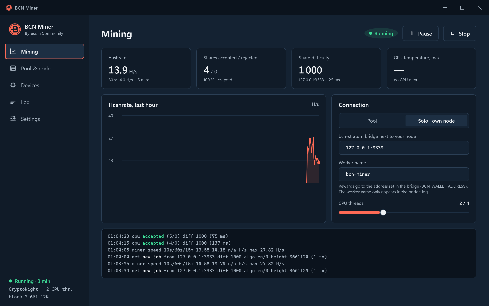

# BCN Miner untuk Windows

[English](README.md) · [Українська](README.uk.md) · [Español](README.es.md) · [Português](README.pt.md) · [Türkçe](README.tr.md) · **Bahasa Indonesia** · [Tiếng Việt](README.vi.md) · [中文](README.zh.md)

Penambang desktop untuk Bytecoin (BCN) yang menambang dengan CPU serta kartu grafis NVIDIA, AMD, dan Intel Arc. Tersedia tema gelap dan terang, dengan antarmuka dalam delapan bahasa.

Ini adalah proyek independen komunitas Bytecoin, tidak berafiliasi dengan para pendiri Bytecoin maupun bcndev.



## Unduh dan jalankan

1. Unduh `BCNMiner-<versi>-win-portable.zip` dari [bytecoin.community](https://bytecoin.community/#downloads), lalu ekstrak di mana saja, bahkan di flashdisk.
2. Jalankan `BCNMiner.exe` lalu tekan **Unduh mesin** (di layar Perangkat atau di spanduk layar Penambangan). Penambang mengunduh rilis resmi [XMRig](https://github.com/xmrig/xmrig) dari GitHub, memeriksa SHA-256-nya, dan untuk kartu NVIDIA menambahkan plugin xmrig-cuda yang sesuai dengan driver Anda. Dari baris perintah, hal yang sama dilakukan dengan `powershell -ExecutionPolicy Bypass -File .\get-engine.ps1`.

Tidak ada yang perlu dipasang: .NET Framework 4.8 sudah tersedia di Windows 10 dan 11.

Windows Defender sering menandai penambang sebagai "perangkat lunak yang mungkin tidak diinginkan". Jika `xmrig.exe` hilang, tambahkan sendiri folder `engine` ke pengecualian Defender.

### Mode portabel

Arsip rilis berisi folder `data`. Selama folder itu ada di samping `BCNMiner.exe`, pengaturan, log, dan cache penyetelan disimpan di sana, sehingga seluruh folder bisa dipindahkan ke PC lain. Hapus `data` agar pengaturan disimpan di `%APPDATA%\BCN Miner`. Pengaturan → Tentang menunjukkan mode yang aktif.

Sakelar "Jalankan bersama Windows" menulis ke registri (`HKCU\...\Run`), dan hanya saat Anda menyalakannya.

## Cara kerja

- **Antarmuka:** `BCNMiner.exe`, WPF di atas .NET Framework 4.8.
- **Mesin:** XMRig dengan algoritme `cn/0`, yaitu CryptoNight asli yang masih dipakai Bytecoin v3.5 (blok v4). Penambang menjalankan XMRig sebagai proses anak, menulis konfigurasinya, dan membaca statistik dari API HTTP lokalnya (hanya `127.0.0.1`, token acak). Jika penambang ditutup atau macet, mesin ikut berhenti.
- **Protokol:** stratum ala Monero (`login` / `job` / `submit` / `keepalived`), sama dengan yang dipakai bytecoin-gui dan jembatan [bcn-stratum](https://github.com/bytecoinBCN-community/bcn-stratum). Nonce berada di byte ke-39 blob, tempat yang diharapkan oleh Antminer X3 maupun XMRig.

Penambang bawaan bytecoin-gui hanya memakai CPU. Dari sanalah daftar pool dengan pool cadangan dan "kesulitan di login" berasal; penambangan GPU disediakan oleh XMRig.

**Tentang `cn/0` di XMRig.** Konfigurasi otomatis XMRig sengaja mematikan `cn/0` di semua backend, jadi konfigurasi biasa gagal dengan `incompatible/disabled algorithm "cn/0"`. Alias `"cn/0": "cn"` juga tidak membantu, karena profil `cn` belum ada saat konfigurasi dibaca. Karena itu, saat pertama kali dijalankan, penambang menjalankan mesin sekali (maksimal 30 dtk) dengan simpan otomatis. Mesin menyetel sendiri profil `cn`: profil ini memakai scratchpad 2 MB dan kernel yang sama dengan `cn/0`, serta memperhitungkan ukuran L3 dan parameter tiap GPU. Penambang menyalin profil ini ke kunci `cn/0` dan menyimpannya di cache `probe.json`. Penyetelan diulang saat Anda menekan Perangkat → Periksa lagi, atau saat GPU, driver, atau versi mesin berubah. GPU yang dimatikan cukup disaring berdasarkan indeksnya.

## Kartu grafis

| Vendor | Backend | Generasi | Catatan |
| --- | --- | --- | --- |
| NVIDIA | CUDA (plugin `xmrig-cuda.dll`) | Pascal (GTX 10), Turing (GTX 16, RTX 20), Ampere (RTX 30), Ada (RTX 40), Blackwell (RTX 50), RTX profesional, dan GPU pusat data | RTX 50 memerlukan plugin yang dibangun dengan CUDA 12.8+; penambang memilih build terbaru yang bisa dijalankan driver Anda (CUDA 12.9 butuh driver 527.41+, driver lama mendapat 11.8 atau 10.2). Suhu, daya, dan kipas berasal dari NVML. |
| AMD | OpenCL | GCN 4 (RX 400/500), Vega, RDNA 1–4 (RX 5000–9000), Radeon Pro, Instinct | Suhu dan daya berasal dari ADL. |
| Intel | OpenCL | Arc A (Alchemist), Arc B (Battlemage) | Eksperimental. Pilih Perangkat → Platform OpenCL → Intel. |
| Grafis terintegrasi | — | Intel UHD/Iris, Radeon di APU | Tidak dipakai: berbagi memori dan pendinginan dengan CPU. |

XMRig hanya mendukung satu platform OpenCL sekaligus. Dalam mode Otomatis, penambang memilih AMD jika ada Radeon diskrit, jika tidak memilih Intel Arc. Setiap kartu dapat dimatikan di layar Perangkat; sakelarnya muncul setelah penambangan pertama, saat mesin melaporkan nomor perangkat.

Saat GPU mana pun mencapai batas (bawaan 80 °C), penambangan dijeda. Penambangan berlanjut setelah suhu kartu turun 8 °C.


## Pool atau solo

- **Pool:** masukkan `host:port` pool utama dan hingga dua pool cadangan, serta alamat publik BCN Anda. Penambang tidak pernah memerlukan kunci atau seed. Instalasi baru dimulai dengan pool komunitas `pool.bytecoin.community:3333` (biaya 0%, PPLNS, <https://pool.bytecoin.community>); tombol "Pool komunitas" di Pool dan node mengembalikannya sebagai pool utama.
- **Solo di node sendiri:** bytecoind v3.5 tidak menyediakan stratum untuk penambang, jadi jembatan [bcn-stratum](https://github.com/bytecoinBCN-community/bcn-stratum) harus berjalan di samping node. Hadiah dikirim ke alamat yang diatur di jembatan (`BCN_WALLET_ADDRESS`); nama worker hanya tampil di log jembatan. Simpan port 3333 dan 8081 di dalam jaringan lokal Anda.

Pool dan node → Uji koneksi mengirim satu `login` dan menampilkan tinggi blok, algoritme, dan kesulitan share.

**Kesulitan share.** Dalam mode Otomatis, penambang mengirim `d=N` ke jembatan sebagai kata sandi, dengan target sekitar satu share setiap 30 dtk. Setelah mulai, penambang memeriksa hashrate dan, bila perlu, memulai ulang mesin dengan kesulitan baru. Minimum di jembatan adalah 1000.

## Profil beban

| Profil | CPU | NVIDIA |
| --- | --- | --- |
| Hemat | prioritas terendah | bfactor 10, jeda antar-batch |
| Seimbang | prioritas di bawah normal | bfactor 6 |
| Maksimum | prioritas normal, tanpa mengalah pada sistem | bfactor 2 |

Penggeser thread CPU menetapkan batas atas. CryptoNight memerlukan 2 MB L3 per thread, dan mesin menurunkan jumlah thread sendiri jika cache terlalu kecil.

## Bahasa

Українська, English, Español, Português, Türkçe, Bahasa Indonesia, Tiếng Việt, 中文 — Pengaturan → Tampilan → Bahasa. Antarmuka langsung berganti; penambangan, log, dan grafik tetap berjalan. "Ikuti sistem" memakai bahasa antarmuka Windows dan beralih ke bahasa Inggris jika bahasa itu tidak tersedia.

Terjemahan ada di `src/lang/<kode>.txt` sebagai baris `kunci = teks` (`{0}` adalah penanda, `\n` pindah baris) dan disematkan saat build. Kunci yang hilang diambil dari bahasa Inggris. Untuk memperbaiki terjemahan tanpa build ulang, letakkan `<kode>.txt` di folder `lang` di samping `BCNMiner.exe`; barisnya menggantikan yang bawaan. Hanya bahasa Ukraina dan Inggris yang ditulis manual; bahasa lain adalah terjemahan mesin, dan koreksi dari penutur asli sangat diharapkan.

## Apa yang bisa diharapkan

Bytecoin ditambang oleh ASIC Antminer X3 (~220 kH/s pada CryptoNight). GPU modern menghasilkan beberapa kH/s pada `cn/0`, sedangkan CPU ratusan H/s. Di sini penambangan GPU lebih untuk mendukung desentralisasi jaringan daripada mencari untung; bandingkan harga listrik dengan hadiahnya sebelum menjalankan beberapa kartu.

XMRig memberikan 1 % waktu sebagai biaya untuk pengembangnya; ini batas minimum di rilis resmi.

## Build

Cukup Windows 10/11, tanpa alat build:
```
powershell -ExecutionPolicy Bypass -File .\build.ps1
```
Folder `dist\` berisi `BCNMiner.exe`, `get-engine.ps1`, README, dan lisensi. `.\build.ps1 -Release` juga membuat `release\BCNMiner-<versi>-win-portable.zip`.

Kodenya C# 5, versi bahasa yang didukung oleh kompiler bawaan .NET Framework (`csc.exe`): tanpa `$"..."`, `?.`, atau anggota berbadan ekspresi.

## Berkas

- `src/App.cs` — mulai program, satu instans, tema, dan bahasa.
- `src/MainWindow.cs` — jendela dan lima layar (Penambangan, Pool dan node, Perangkat, Log, Pengaturan), baki sistem, pelindung panas berlebih, kesulitan otomatis.
- `src/Engine.cs` — konfigurasi XMRig, penyetelan `cn/0`, proses, API HTTP, Job Object.
- `src/Gpu.cs` — GPU dari WMI: vendor, arsitektur, ukuran VRAM sebenarnya dari registri.
- `src/Net.cs` — penguraian `host:port`, uji stratum, kesulitan dari target.
- `src/L.cs`, `src/lang/*.txt` — terjemahan.
- `src/Theme.cs`, `src/Styles.xaml`, `src/Ui.cs`, `src/Chart.cs` — sistem desain dan grafik.
- `get-engine.ps1` — unduhan mesin dengan pemeriksaan SHA-256.

## Lisensi

BCN Miner dilisensikan di bawah [GNU LGPL v3.0](LICENSE) (yang melengkapi [GNU GPL v3.0](COPYING)). XMRig dan xmrig-cuda berlisensi GPL-3.0; keduanya bukan bagian dari repositori ini dan diunduh dari rilis resminya oleh `get-engine.ps1`.
